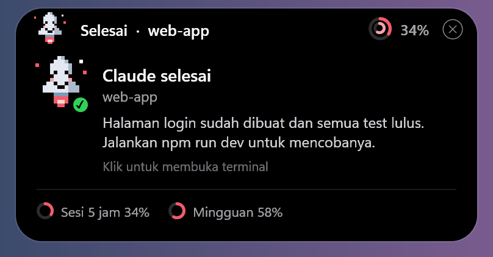
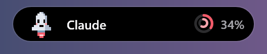
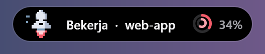
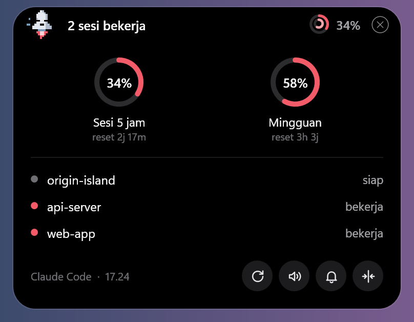
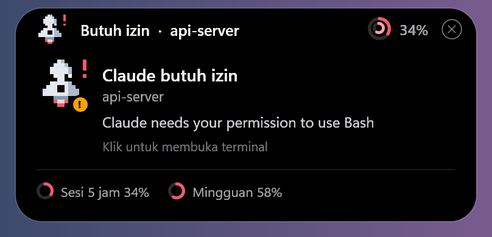

# Origin Island

**Notifikasi ala Dynamic Island untuk [Claude Code](https://claude.com/claude-code) di Windows, dengan atau tanpa WSL.**

Pil kecil di atas layar ini memberi tahu saat Claude selesai, butuh izin, atau gagal. Pemakaian kuota juga
selalu terlihat, jadi Anda tidak perlu terus mengecek terminal.

Dibuat oleh **[Gus Khamim](https://guskhamim.com)** · [Situs resmi](https://amimhayden22.github.io/origin-island/)



## Pasang

Salin pesan ini ke Claude Code:

> Tolong pasang Origin Island dari https://github.com/amimhayden22/origin-island. Ikuti bagian
> "Untuk Claude Code" di README-nya.

Setujui saat Claude meminta izin. Setelah selesai, keluar dari Claude Code, jalankan `claude` lagi, lalu kirim
satu pesan. Pil akan muncul di tengah atas layar.

### Yang dibutuhkan

- Windows 10 atau 11.
- Claude Code yang sudah terpasang dan login.
- Langganan Claude agar kuota tampil. Dengan API key, notifikasi tetap jalan tanpa kuota.
- Pengguna WSL juga butuh `python3`, yang sudah ada di Ubuntu.

### Pasang sendiri

Jalankan perintah ini di PowerShell:

```powershell
irm https://raw.githubusercontent.com/amimhayden22/origin-island/main/install.ps1 | iex
```

Lalu pilih versinya. Tidak yakin? Tekan Enter.

```text
Pasang Origin Island untuk:
  [1] Windows (direkomendasikan)
  [2] Windows + WSL (biasanya untuk programmer)
```

| Claude Anda dibuka dari | Pilih |
|---|---|
| PowerShell atau Command Prompt | Windows |
| Terminal Ubuntu/WSL | Windows + WSL |

Anda juga bisa mengunduh ZIP sesuai versi di [halaman rilis](https://github.com/amimhayden22/origin-island/releases/latest),
mengekstraknya, lalu mengklik dua kali `Pasang.cmd`. Setelah memasang, buka ulang Claude Code.

### Untuk Claude Code

Petunjuk bagi Claude Code yang diminta memasang Origin Island:

1. Tentukan tempat Anda berjalan: WSL bila `uname -r` berisi `microsoft`, selain itu Windows.
2. **WSL:** jalankan `git clone https://github.com/amimhayden22/origin-island.git`, lalu
   `cd origin-island && ./install.sh`.
3. **Windows:** jalankan
   `powershell -NoProfile -ExecutionPolicy Bypass -Command "irm https://raw.githubusercontent.com/amimhayden22/origin-island/main/install.ps1 | iex"`.
   Menu pilihan otomatis dilewati.
4. Beri tahu pengguna bahwa installer mengubah `settings.json` Claude Code, dan `~/.bashrc` di WSL.
5. Minta pengguna membuka ulang Claude Code. Tanpa itu, angka kuota tidak diperbarui.

## Fitur

- **Notifikasi + suara:** saat Claude selesai, butuh izin, atau gagal.
- **Kuota:** pemakaian 5 jam dan mingguan, serta waktu reset.
- **Klik ke terminal:** membuka terminal tempat Claude berjalan.
- **Banyak sesi:** semua sesi tampil di satu pil.
- **Mengikuti layar:** pil bisa digeser ke monitor lain, dan bersembunyi saat ada video atau game layar penuh.
- **Maskot Ogin:** roket pixel yang menunjukkan apa yang sedang Claude lakukan.

## Tampilan

| Kondisi | Tampilan |
|---|---|
| **Siaga** |  |
| **Bekerja** |  |
| **Saat kursor di atas pil** |  |
| **Butuh izin** |  |
| **Selesai** |  |

## Cara memakai

- **Arahkan kursor** ke pil untuk melihat kuota, sesi aktif, dan pengaturan.
- **Klik** pil, notifikasi, atau baris sesi untuk membuka terminalnya.
- **Geser** pil untuk memindahkannya.

| Ikon di panel | Fungsi |
|---|---|
| Panah melingkar | Mengecek kuota terakhir. Angkanya berubah setelah Claude merespons |
| Speaker | Menyalakan atau mematikan suara |
| Slider Volume | Mengatur besar suara |
| Lonceng | Memutar suara untuk mengecek volume |
| Panah ke tengah | Mengembalikan pil ke tengah atas layar |
| Tempat sampah | Menghapus Origin Island, dengan konfirmasi |
| Garis di kanan atas | Mengecilkan pil jadi maskot saja. Klik maskot untuk menampilkan lagi |
| X di kanan atas | Menutup pil sampai Claude dipakai lagi |

## Keamanan dan pemakaian laptop

- **Akun:** secara bawaan, Origin Island tidak membaca token login dan tidak mengirim data ke internet.
- **Data:** cuplikan pesan dan balasan disimpan di `events.jsonl` di komputer Anda untuk ditampilkan di pil.
- **Startup:** Origin Island tidak ikut menyala saat laptop dinyalakan. Pil menyala saat Claude Code dipakai.
- **Pemakaian:** saat siaga di laptop 16 inti, kurang dari 1% CPU dan sekitar 200 MB memori.

## Menghapus

Klik ikon tempat sampah di panel, lalu konfirmasi. Setelan Claude Code Anda yang lain tidak berubah. Kalau versi
Windows dan WSL terpasang, keduanya ikut terhapus. Dari terminal WSL, Anda juga bisa menjalankan `./uninstall.sh`.

## Masalah yang sering muncul

- **Pil tidak muncul:** kirim satu pesan ke Claude Code, lalu cek `%LOCALAPPDATA%\OriginIsland\island.log`.
- **Kuota berbeda dengan `/usage`:** cek jam di kiri bawah panel. Kalau sudah lama atau muncul "Kuota beku", buka
  ulang Claude Code. Pemakaian di perangkat lain baru terlihat setelah Claude merespons.
- **Kuota tidak tampil:** pastikan login dengan langganan Claude, lalu kirim satu pesan. Kuota juga tidak tampil
  kalau Anda sudah memakai statusline sendiri.
- **Klik tidak memilih tab yang tepat di WSL:** tambahkan `"suppressApplicationTitle": false` pada profil distro
  di setelan Windows Terminal.
- **Diblokir antivirus:** izinkan `%LOCALAPPDATA%\OriginIsland\start-island.vbs`.
- **Lapor masalah:** buka [issue](https://github.com/amimhayden22/origin-island/issues) dan sertakan `island.log`.

## Batasan

- Klik di Windows tanpa WSL memunculkan jendela terminal, tetapi belum memilih tab yang tepat.
- Klik di VS Code memunculkan jendelanya, tetapi belum memilih panel terminal.
- Kalau ada beberapa tab WSL dengan judul terkunci, klik hanya memunculkan jendelanya.
- Deteksi Esc membaca file internal Claude Code, jadi bisa berhenti bekerja setelah Claude Code diperbarui.

## Pengaturan lanjutan

Ubah `%LOCALAPPDATA%\OriginIsland\config.json`:

| Kunci | Bawaan | Arti |
|---|---|---|
| `notifySeconds` | `8` | Lama notifikasi tampil |
| `sound` | `true` | Suara notifikasi |
| `soundVolume` | `1.0` | Volume, 0 sampai 1 |
| `soundDone`, `soundAttention`, `soundError` | file di `sounds/` | Path Windows ke suara sendiri |
| `hideOnFullscreen` | `true` | Sembunyi saat video atau game layar penuh |
| `exitWhenWslStops` | `true` di versi WSL | Keluar saat WSL berhenti |
| `usageApiFallback` | `false` | API kuota cadangan |
| `pollSeconds` | `300` | Jeda minimum API kuota cadangan |

**`usageApiFallback`** membuat Origin Island mengambil kuota langsung dari server saat datanya lebih tua dari 10
menit. Untuk itu ia **membaca token login** dan memakai endpoint yang tidak terdokumentasi, jadi aktifkan dengan
risiko sendiri.

## Cara kerja

```text
Claude Code --hook-------> events.jsonl -+
Claude Code --statusline-> usage.json  --+--> Origin Island (PowerShell + WPF)
```

Hook dan statusline ditambahkan ke `settings.json` Claude Code, dengan cadangan `settings.json.bak-island`.
Statusline yang sudah ada tidak ditimpa. Aplikasinya ada di `%LOCALAPPDATA%\OriginIsland\`.

## Lisensi dan kredit

- Kode: [MIT](LICENSE).
- Maskot Ogin dan ikon: karya Gus Khamim.
- Suara Notifikasi dari [Pixabay](https://pixabay.com/id/).
